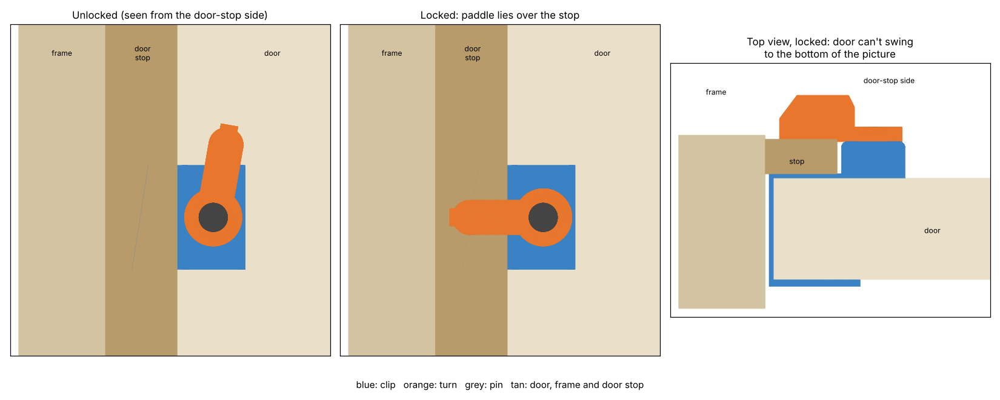

# Hug lock: a 3D-printable no-tools door lock

A child lock for interior doors, in the same family as the SnapPower HugLock
and similar Amazon "hug locks". It needs no screws, no adhesive and doesn't mark
the door.



## How it works

1. A U-shaped clip (blue) slides over the **latch edge** of the door, high up and
   out of a child's reach.
2. On the **door-stop side** (the side the door swings *away* from), a turn
   (orange) sits just proud of the door stop.
3. Turn it so the paddle lies flat towards the frame and it hooks over the back
   of the door stop. The door can't swing open.
4. Turn it back to upright and the door works as normal.

Gravity holds the paddle in both positions. It rests on an end-stop when
locked (flat) and when unlocked (just past upright), so it won't drift.

The lock is worked from the door-stop side only. That suits keeping a child
**out** of a room. **Do not use it to shut a child in.** Nobody on the other
side can open it in a fire.

## Parts

| File | Qty | Notes |
|---|---|---|
| `hug_lock_body.stl` | 1 | The clip. Already oriented with the U-profile flat on the bed. |
| `hug_lock_turn_left.stl` | 1 | Use this one if the **frame is on your left** as you face the door-stop side. |
| `hug_lock_turn_right.stl` | 1 | Use this one if the frame is on your right. Mount the clip with the turret on that side. |
| `hug_lock_pin.stl` | 1 | Hex pin with snap lips. Already lying on a flat. |

Push the pin down through the turn and then the clip until the lips click into
the pocket underneath. The hex keys the turn to the pin, and the pin spins in
the clip.

## Print settings

- **PETG** is best because the clip has to flex. PLA works but can crack after
  repeated fitting.
- 0.2 mm layers, 4 walls, 30–40 % infill. No supports needed.
- Print the body on its side, as exported. The layers then run around the U,
  which makes it much stronger than printing it standing up.

## Measure your door first

The defaults are a typical UK internal door. Measure yours and change `PARAMS`
at the top of `hug_lock.py`:

| Parameter | Default | What to measure |
|---|---|---|
| `door_thickness` | 35 mm | Door thickness (35 / 40 / 44 mm are common) |
| `stop_thickness` | 12 mm | How far the door stop stands proud of the closed door's face |
| `stop_overlap` | 22 mm | How far the stop reaches over the door face, from the door's edge |

Then regenerate the parts:

```bash
pip install cadquery matplotlib
python3 hug_lock.py        # checks clearances, writes the STLs
python3 render_preview.py  # optional: redraws preview.png
```

`hug_lock.py` checks the geometry before it writes anything. It confirms the turn
doesn't collide with the clip in either position, that the end-stops actually
stop it, that the clip clears the door stop, and that the paddle sits over the
stop only when locked.

## Limitations

- The 1.6 mm leg is pinched between the door and the door stop, and a 1.6 mm
  bridge sits in the gap at the door edge. A very tight-fitting door may not
  close fully with it on. Thin the leg with `leg` / `bridge` if you need to,
  but it gets weaker.
- It's a child lock, not a security lock. A determined adult can force it.
